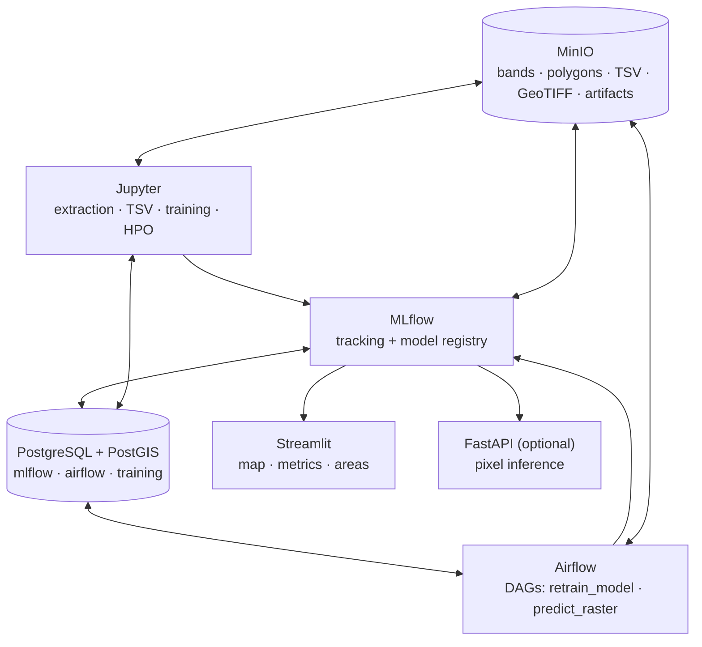

# Sentinel-2 land-cover classification · MLOps stack

Local MLOps platform for the ML101 final project: pixel-level land-cover classification of a Sentinel-2 L2A scene over Bogotá (tile T18NWL, 10 bands at 20 m). The stack runs with docker compose and mirrors the project phases: phase 1 (extraction, TSV dataset, training and HPO in Jupyter, tracked in MLflow) and phase 2 (Airflow DAGs to retrain and classify the full scene, a Streamlit dashboard and an optional FastAPI).

## Quick start

```bash
docker compose up -d --build                                  # whole stack
docker compose up -d --build postgres minio mlflow jupyter    # phase 1 services only
docker compose down                                           # stop everything (-v also drops the data)
```

The first build downloads the geospatial stack (rasterio, geopandas) and takes a few minutes. On Linux replace the Airflow user `50000` in `apps/airflow/compose.yml` with `id -u` before starting Airflow.

## Architecture



| Service | Phase | URL | Credentials | Role |
|---------|-------|-----|-------------|------|
| `postgres` | 1 | `localhost:5432` | `postgres` / `postgres` | One PostGIS instance with the databases `mlflow`, `airflow` and `training` (own user each, see `docker-compose.yml`) |
| `minio` | 1 | console <http://localhost:9001>, S3 `localhost:9000` | `minioadmin` / `minioadmin` | Buckets `mlflow` (artifacts) and `sentinel2` (`bands/`, `polygons/`, `tsv/`, `predictions/`) |
| `mlflow` | 1 | <http://localhost:5001> | none | Tracking server and model registry; artifacts proxied to MinIO |
| `jupyter` | 1 | <http://localhost:8888/?token=sentinel2> | token `JUPYTER_TOKEN` | JupyterLab with rasterio, geopandas, scikit-learn, optuna, mlflow; `./notebooks` and `./data` mounted |
| `airflow-apiserver` | 2 | <http://localhost:8080> | `airflow` / `airflow` | DAGs `upload_bands`, `load_polygons`, `extract_training_samples`, `retrain_model` and `predict_raster` (the last two are skeletons) in `apps/airflow/dags`; `./data` mounted read-only |
| `streamlit` | 2 | <http://localhost:8501> | none | Map, metrics of the production model and class areas |
| `api` | 2 (optional) | <http://localhost:8000/docs> | none | `POST /predict/pixel`, `GET /health`, `GET /model-info`, `POST /model/reload` |

Every value (ports, credentials, image tag, bucket and model names) is written in `docker-compose.yml` and `apps/airflow/compose.yml`; there is no `.env` file. They are local development defaults: a value shared by several services must be changed everywhere it appears.

## Data flow

0. **Ingestion (Airflow).** `upload_bands` streams the ten `.jp2` bands out of `./data/imagery-sentinel2-bog-band.zip` into `s3://sentinel2/bands/` and verifies their sizes. It is idempotent: bands already stored with the same size are skipped. Another archive can be passed with the `archive` param. `load_polygons` validates `./data/PolygonsClasses.tsv` (columns `WKT`, `fid`, `class`) and loads the ground-truth polygons into `raw.polygon_classes` (EPSG:32618, the CRS of the scene) in one transaction that replaces the rows of the same file. Another file can be passed with the `polygons` param.
1. **Extraction (Airflow).** `extract_training_samples` builds the training dataset in three layers. `extracted.polygon_pixels` holds every pixel whose centre lies inside a polygon of `raw.polygon_classes`, with the digital numbers of the ten bands read from `s3://sentinel2/bands/` and its latitude and longitude, nothing filtered out. `training.samples` keeps one row per clean pixel: pixels with no data in a band or claimed by polygons of different classes are dropped. The TSV with `Latitude`, `Longitude`, the bands in `BAND_NAMES` order and `Class` is exported to `s3://sentinel2/tsv/<scene>.tsv`, where the notebooks read it. Run it after `upload_bands` and `load_polygons`; every step replaces the rows of its scene.
2. **Training and HPO (Jupyter).** Train the six architectures, tune them and log params, metrics (overall accuracy, kappa, precision, recall, F1) and confusion matrices as MLflow runs of the experiment `MLFLOW_EXPERIMENT_NAME`. Register the winner as `MODEL_NAME` and give it the alias `MODEL_ALIAS` (`production`).
3. **Retrain and inference (Airflow).** `retrain_model` repeats step 2 from `training.samples`; `predict_raster` loads `models:/sentinel2-land-cover@production`, classifies the whole scene keeping the original CRS, uploads the GeoTIFF to `s3://sentinel2/predictions/` and stores the area per class in `training.class_areas`.
4. **Visualisation.** Streamlit shows the predicted raster, the metrics of the production model and the class areas; the API classifies a single pixel from its ten band values.

## Repository layout

```text
.
├── docker-compose.yml            # root stack; includes apps/airflow/compose.yml
├── apps/
│   ├── mlflow/                   # official image + psycopg2 + boto3
│   ├── jupyter/                  # scipy-notebook + geospatial and MLOps libraries
│   ├── airflow/                  # image, compose slice and skeleton DAGs
│   ├── streamlit/                # dashboard
│   └── api/                      # optional FastAPI
├── infra/database/
│   ├── init/                     # creates the three databases and enables PostGIS
│   ├── migrate.sh                # applies migrations/ to the training database
│   └── migrations/               # schemas raw (source files), extracted (pixels inside the polygons), training (dataset, class areas)
├── notebooks/                    # phase 1 notebooks (mounted in Jupyter) and their outputs/
├── docs/                         # reports (LaTeX and PDF) and the script that builds their tables
└── data/                         # local scene, polygons and rasters (git-ignored)
```

## Operation

| Task | How |
|------|-----|
| Build the phase 1 report | Run `notebooks/01_phase1_training.ipynb`, then `python3 docs/build_tables.py` and `latexmk -pdf phase1_report.tex` inside `docs/` |
| Open JupyterLab | <http://localhost:8888/?token=sentinel2>; notebooks persist in `./notebooks` |
| Copy the scene into MinIO | `mc` from the host or the MinIO console: bucket `sentinel2`, prefix `bands/` |
| Query the training database | `docker compose exec postgres psql -U training -d training` |
| Add a migration | New file in `infra/database/migrations` (name order) and `docker compose up train-db-migrate` |
| Trigger a DAG | Airflow UI, or `docker compose exec airflow-scheduler airflow dags trigger predict_raster` |
| Change the served model | Move the alias in the MLflow UI (Models → version → alias) or with `MlflowClient().set_registered_model_alias` |
| Reset everything | `docker compose down -v` (drops databases and buckets) |

## Troubleshooting

- MLflow answers `403` from another machine: add the host to `--allowed-hosts` in the `mlflow` command of `docker-compose.yml` (and `--cors-allowed-origins <origin>` for its origin).
- `/predict/pixel` answers `503`: no model carries the `production` alias yet, or MLflow is unreachable; `GET /model-info` shows the error.
- Airflow cannot write `apps/airflow/logs` on Linux: replace the user `50000` in `apps/airflow/compose.yml` with `id -u` and recreate the containers.
- Database credentials changed in the compose files but login fails: they are applied when the volume is first created; run `down -v` or change them inside Postgres.
