# Sentinel-2 land-cover classification · MLOps stack

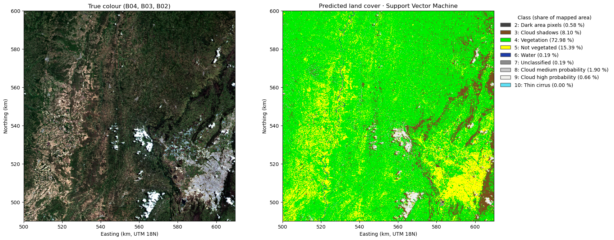

Local MLOps platform for the ML101 final project: pixel-level land-cover classification of a Sentinel-2 L2A scene over Bogotá (tile T18NWL, 10 bands at 20 m). One `docker compose` stack takes the scene from the raw bands to a classified map: Airflow ingests the data, Jupyter trains and selects the model, MLflow tracks and registers it, and a Streamlit dashboard and a FastAPI service show the result.

## Quick path

1. Put `imagery-sentinel2-bog-band.zip` and `PolygonsClasses.tsv` in `./data`.
2. Start the stack: `docker compose up -d --build`.
3. Run the Airflow DAGs `upload_bands`, `load_polygons` and `extract_training_samples`, in that order.
4. Run the notebooks `01_phase1_training`, `02_phase2_tuning` and `05_scene_inference`, in that order.
5. Open the dashboard at <http://localhost:8501> and press **Refresh**.

The whole run takes about five hours, almost all of it in the last notebook. [Run it end to end](#run-it-end-to-end) has every step with its expected result.

## System architecture

Every box is a container of the stack. Jupyter and Airflow are the only services that produce data; Streamlit and the API only read.

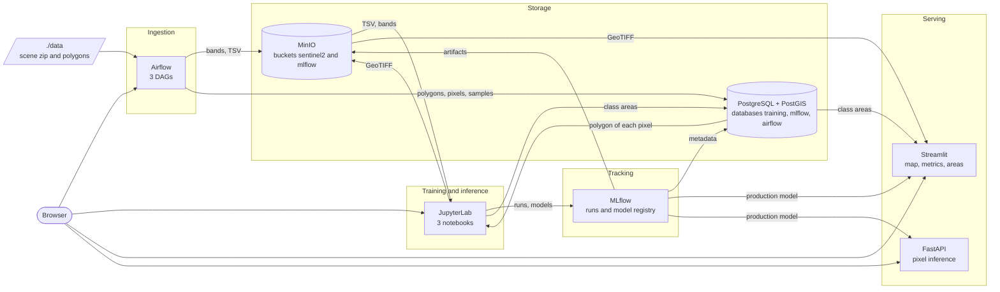

| Service | URL | Credentials | Role |
|---------|-----|-------------|------|
| `airflow-apiserver` | <http://localhost:8080> | `airflow` / `airflow` | DAGs `upload_bands`, `load_polygons` and `extract_training_samples` in `apps/airflow/dags`; `./data` mounted read-only |
| `jupyter` | <http://localhost:8888/?token=sentinel2> | token `JUPYTER_TOKEN` | JupyterLab with rasterio, geopandas, scikit-learn and mlflow; `./notebooks` and `./data` mounted |
| `mlflow` | <http://localhost:5001> | none | Tracking server and model registry; artifacts proxied to MinIO |
| `streamlit` | <http://localhost:8501> | none | Predicted map, metrics of the production model and class areas |
| `api` | <http://localhost:8000/docs> | none | `POST /predict/pixel`, `GET /health`, `GET /model-info`, `POST /model/reload` |
| `minio` | console <http://localhost:9001>, S3 `localhost:9000` | `minioadmin` / `minioadmin` | Buckets `sentinel2` (data) and `mlflow` (artifacts) |
| `postgres` | `localhost:5432` | `postgres` / `postgres` | One PostGIS instance with the databases `training`, `mlflow` and `airflow`, each with its own user |

Three one-shot containers prepare the stack and exit: `minio-init` creates the buckets, `train-db-migrate` applies `infra/database/migrations` and `airflow-init` prepares the Airflow database.

Every value (ports, credentials, image tags, bucket and model names) is written in `docker-compose.yml` and `apps/airflow/compose.yml`; there is no `.env` file. They are local development defaults: a value shared by several services must be changed everywhere it appears.

## Data architecture

### Lineage

The data moves through four layers. Each step replaces the rows or objects of its own scene, so every step can be run again.

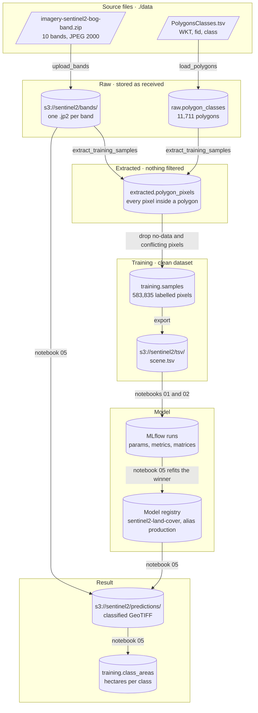

### Where the data lives

| Store | Location | Content | Written by |
|-------|----------|---------|------------|
| MinIO `sentinel2` | `bands/` | The ten `.jp2` bands of the scene | DAG `upload_bands` |
| MinIO `sentinel2` | `tsv/` | Training dataset: `Latitude`, `Longitude`, the ten bands, `Class` | DAG `extract_training_samples` |
| MinIO `sentinel2` | `predictions/` | Classified scene as a single-band GeoTIFF with its colour table | Notebook 05 |
| MinIO `mlflow` | per run and per model | Models, confusion matrices and search results | MLflow |
| PostgreSQL `training` | schemas `raw`, `extracted`, `training` | Tables of the diagram below | DAGs and notebook 05 |
| PostgreSQL `mlflow` | MLflow schema | Experiments, runs and registry metadata | MLflow |
| PostgreSQL `airflow` | Airflow schema | DAG runs and task state | Airflow |

### Training database

The lines show how rows derive from each other; the tables declare no foreign keys. The table names stand for `raw.polygon_classes`, `extracted.polygon_pixels`, `training.samples` and `training.class_areas`.

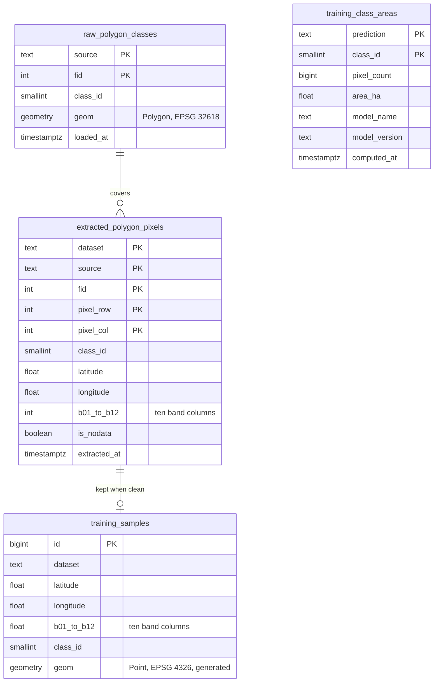

## Flows

### End to end

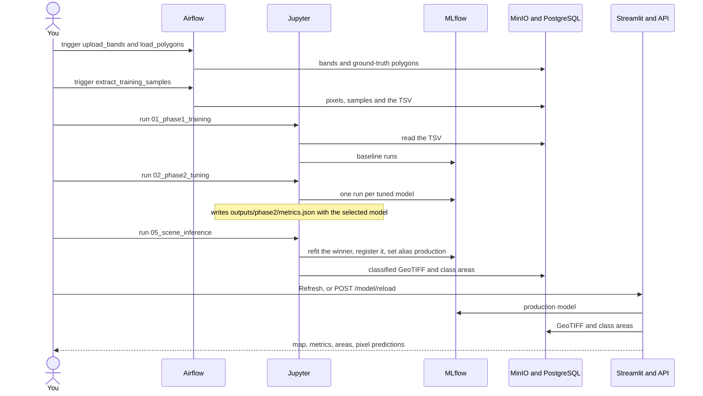

### Model selection

Notebook 02 decides which model reaches production. Pixels of one polygon never fall on both sides of a split, so the scores are not inflated by neighbouring pixels.

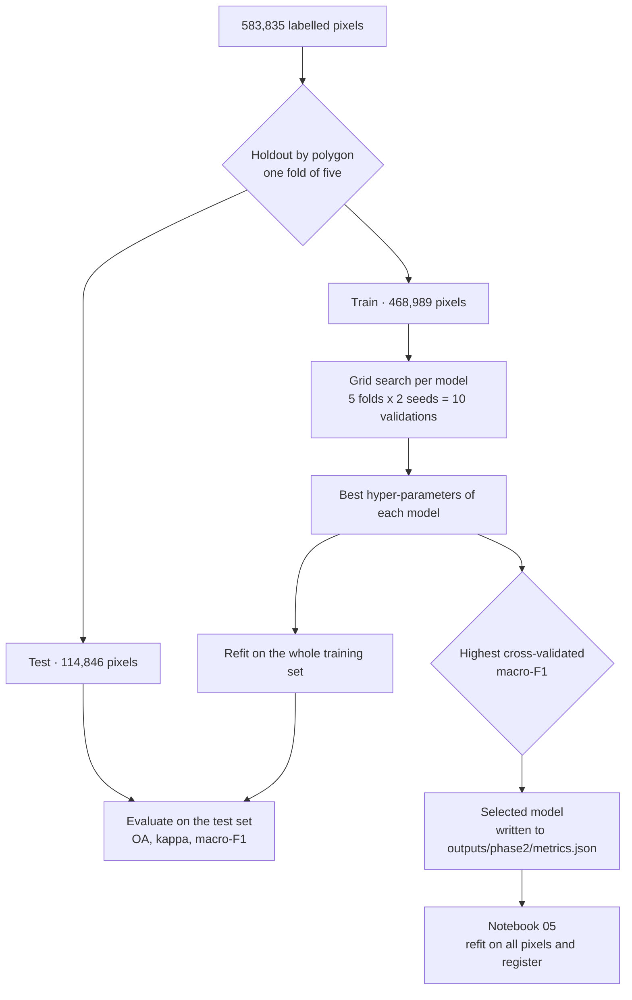

The candidates are Logistic Regression, Naive Bayes, Decision Tree, Random Forest, Gradient Boosting, K-Nearest Neighbors, Support Vector Machine and a neural network (MLP), plus a most-frequent-class baseline. Random Forest, Gradient Boosting, KNN, SVM and the MLP are tuned on a 25 % sample of the training pixels to keep the search affordable.

### Pixel inference

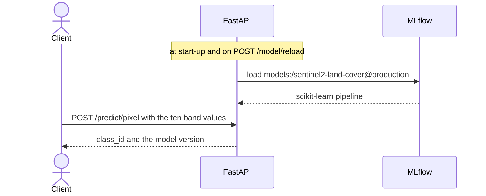

## Run it end to end

### Before you start

| Requirement | Detail |
|-------------|--------|
| Docker with compose | Docker Desktop, OrbStack or Docker Engine |
| Resources for Docker | The reference run had 15 cores and 16 GB and peaked near 8 GB; fewer cores only make it slower |
| Scene | `data/imagery-sentinel2-bog-band.zip` |
| Ground truth | `data/PolygonsClasses.tsv` with the columns `WKT`, `fid`, `class` |

`./data` is git-ignored, so both files have to be copied in by hand.

### Step 1 · Start the stack

```bash
docker compose up -d --build
docker compose ps
```

The first build downloads the geospatial libraries and takes a few minutes. Continue when every service reports `healthy`. On Linux, replace the Airflow user `50000` in `apps/airflow/compose.yml` with the output of `id -u` before starting.

### Step 2 · Ingest the scene and build the dataset

Trigger the three DAGs in order from the Airflow UI at <http://localhost:8080>, or from a terminal:

```bash
docker compose exec airflow-scheduler airflow dags trigger upload_bands
docker compose exec airflow-scheduler airflow dags trigger load_polygons
docker compose exec airflow-scheduler airflow dags trigger extract_training_samples
```

Wait for each run to succeed before the next one; `extract_training_samples` needs the output of the other two.

```bash
docker compose exec airflow-scheduler airflow dags list-runs extract_training_samples
docker compose exec postgres psql -U training -d training -c "SELECT count(*) FROM training.samples"
```

Expected result: the three runs in `success` and 583,835 rows in `training.samples`. The dataset is also exported to `s3://sentinel2/tsv/T18NWL_20260810T152649.tsv`.

The `scene` parameter of `extract_training_samples` can stay empty while the bucket holds a single scene.

### Step 3 · Train and select the model

Open JupyterLab at <http://localhost:8888/?token=sentinel2> and run each notebook once with **Run → Run All Cells**.

| Notebook | What it does | Expected result |
|----------|--------------|-----------------|
| `01_phase1_training.ipynb` | Splits the pixels by polygon and trains the baselines (Logistic Regression, Decision Tree, Naive Bayes) | `notebooks/outputs/phase1/metrics.json` |
| `02_phase2_tuning.ipynb` | Tunes the eight models, evaluates them on the holdout and selects one | `notebooks/outputs/phase2/metrics.json` with the `selected` model |

Run 01 first: notebook 02 checks that its split matches the one of phase 1.

Follow notebook 02 from a terminal, since it prints nothing while a model trains:

```bash
tail -f notebooks/outputs/phase2/progress.log
```

It is finished when the log shows `selected by cross-validated macro-F1: <model>`.

Notebook 02 reuses the grid searches saved in `notebooks/outputs/phase2/cv_results_*.csv`. Delete those files to repeat the search from scratch, which takes considerably longer.

### Step 4 · Classify the scene

Run `05_scene_inference.ipynb` with **Run → Run All Cells**. It reads the selected model from `outputs/phase2/metrics.json`, refits it on all the labelled pixels, registers it as `sentinel2-land-cover` with the alias `production`, classifies the 30 million pixels of the scene and stores the result.

Set `N_JOBS` in its first cell to the number of cores of the machine minus one before running it: the classification is the longest step and scales with it.

Expected result:

```bash
docker compose exec postgres psql -U training -d training -c "SELECT class_id, area_ha FROM training.class_areas ORDER BY class_id"
```

One row per class, plus the GeoTIFF in `s3://sentinel2/predictions/` and in `./data/predictions/`, and the maps in `notebooks/outputs/inference/`.

### Step 5 · See the result

| Where | What to do |
|-------|------------|
| Dashboard, <http://localhost:8501> | Press **Refresh**. The **Map** tab shows the classified scene, **Metrics** the production model and **Areas** the hectares per class |
| MLflow, <http://localhost:5001> | Compare the runs of the experiment `sentinel2-land-cover` and see the registered model |
| API, <http://localhost:8000/docs> | Reload the model, then classify a pixel |

The API looks for the production model when it starts, so it has to be told that one now exists:

```bash
curl -X POST http://localhost:8000/model/reload

curl -X POST http://localhost:8000/predict/pixel \
  -H 'content-type: application/json' \
  -d '{"bands": {"B01": 300, "B02": 350, "B03": 600, "B04": 400, "B05": 1100, "B06": 2600, "B07": 3100, "B8A": 3400, "B11": 1800, "B12": 900}}'
```

The band values use the same units as the training TSV. The answer carries the `class_id` and the model version.

### How long it takes

Measured on a 15-core Apple M5 Pro with 16 GB given to Docker.

| Step | Time | Why |
|------|------|-----|
| Three DAGs | 1 min | Small files and one scene |
| Notebook 01 | not measured, short | Three light models |
| Notebook 02 | 70 min | The SVM alone takes 53 min and trains on a single core |
| Notebook 05, refit | 70 min | The same SVM on all the pixels |
| Notebook 05, classification | 2 h 25 min with `N_JOBS = 14` | 30 million pixels; an earlier run with `N_JOBS = 8` took 5 h |

### Keep a long run alive

- **Keep the machine awake.** A sleeping host pauses the containers. On macOS run `caffeinate -is` in another terminal while the notebooks work; a locked screen is harmless.
- **Queue each notebook once.** Cells queued twice run twice, and notebook 02 would repeat an hour of evaluation.
- **Restart instead of interrupting.** The SVM does not respond to **Interrupt Kernel** until its fit ends; use **Restart Kernel** to stop it at once.
- **Expect a four-minute pause** when notebook 05 loads the selected model from MLflow. It retries a request before finding the model and then continues.
- **Save before closing.** Save the notebook when it finishes so its outputs reach the file.

### Checklist

- [ ] Every service is `healthy` in `docker compose ps`.
- [ ] The three DAGs ended in `success` and `training.samples` has rows.
- [ ] `notebooks/outputs/phase2/metrics.json` names a `selected` model.
- [ ] MLflow shows `sentinel2-land-cover` with the alias `production`.
- [ ] `s3://sentinel2/predictions/` holds a GeoTIFF and `training.class_areas` has rows.
- [ ] The dashboard shows the map and `GET /model-info` answers `ready`.

### Stop

```bash
docker compose down        # stop and keep the data
docker compose down -v     # stop and drop databases and buckets
```

## Repository layout

```text
.
├── docker-compose.yml            # root stack; includes apps/airflow/compose.yml
├── apps/
│   ├── mlflow/                   # official image + psycopg2 + boto3
│   ├── jupyter/                  # scipy-notebook + geospatial and MLOps libraries
│   ├── airflow/                  # image, compose slice and ingestion DAGs
│   ├── streamlit/                # dashboard
│   └── api/                      # FastAPI pixel inference
├── infra/database/
│   ├── init/                     # creates the three databases and enables PostGIS
│   ├── migrate.sh                # applies migrations/ to the training database
│   └── migrations/               # schemas raw, extracted and training
├── notebooks/                    # training, tuning and inference notebooks and their outputs/
├── docs/                         # reports (LaTeX and PDF) and the script that builds their tables
└── data/                         # local scene, polygons and rasters (git-ignored)
```

## Operation

| Task | How |
|------|-----|
| Build the phase 1 report | Run notebooks 01 and 02, then `python3 docs/build_tables.py` and `latexmk -pdf phase1_report.tex` inside `docs/` |
| Query the training database | `docker compose exec postgres psql -U training -d training` |
| Add a migration | New file in `infra/database/migrations` (name order) and `docker compose up train-db-migrate` |
| Use another scene or polygons file | Pass the `archive` param to `upload_bands` or the `polygons` param to `load_polygons` |
| Change the served model | Move the alias in the MLflow UI (Models → version → alias), then `POST /model/reload` |
| Apply a change to the dashboard or the API | `docker compose up -d --build streamlit` (or `api`); their code is copied into the image |
| Reset everything | `docker compose down -v` |

## Troubleshooting

- The dashboard or the API reports no production model after notebook 05 finished: press **Refresh** in the dashboard and call `POST /model/reload` in the API.
- `/predict/pixel` answers `503`: no model carries the `production` alias yet, or MLflow is unreachable; `GET /model-info` shows the error.
- A notebook looks stuck at 0 % CPU for a few minutes at the start of notebook 05: it is the pause described in [Keep a long run alive](#keep-a-long-run-alive).
- MLflow answers `403` from another machine: add the host to `--allowed-hosts` in the `mlflow` command of `docker-compose.yml` (and `--cors-allowed-origins <origin>` for its origin).
- Airflow cannot write `apps/airflow/logs` on Linux: replace the user `50000` in `apps/airflow/compose.yml` with `id -u` and recreate the containers.
- Database credentials changed in the compose files but login fails: they are applied when the volume is first created; run `down -v` or change them inside Postgres.

## Evidence

Screenshots of the reference run, in the order of the pipeline.

### Airflow · ingestion DAGs

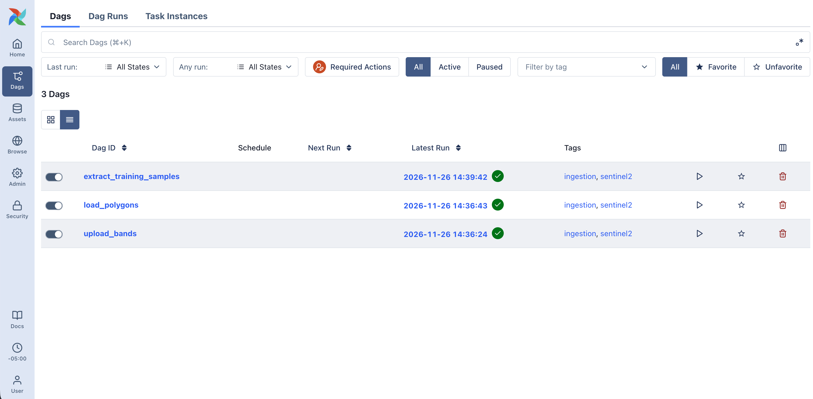

### MinIO · data bucket

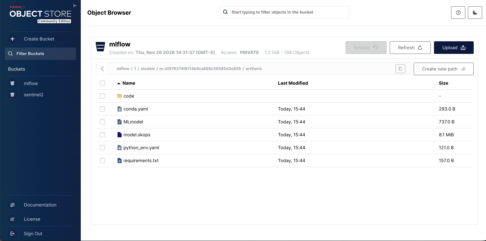

### JupyterLab · notebooks

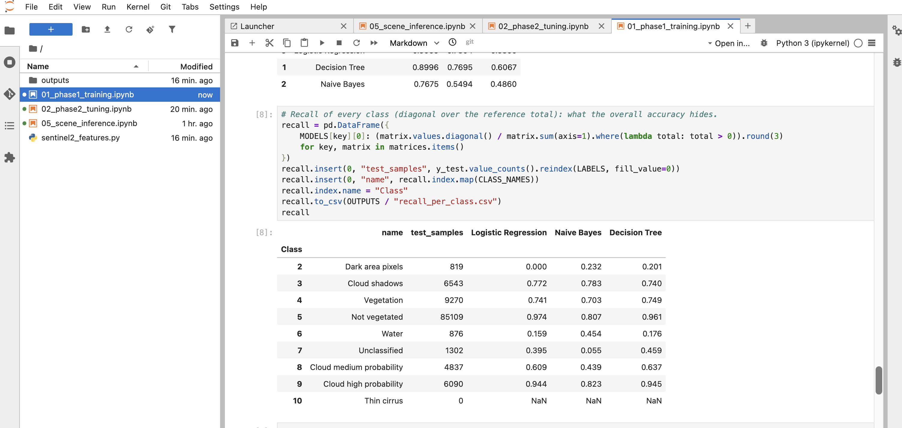

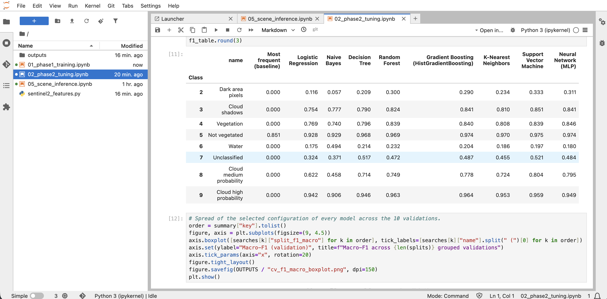

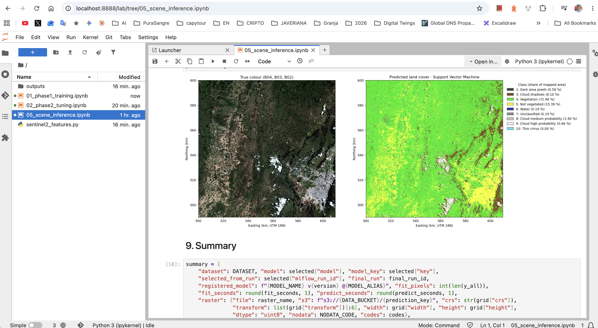

### MLflow · runs and registered model

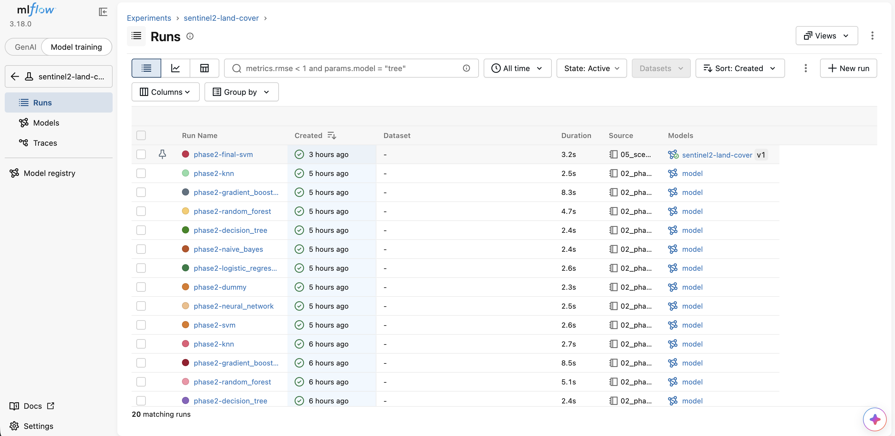

### Streamlit · dashboard

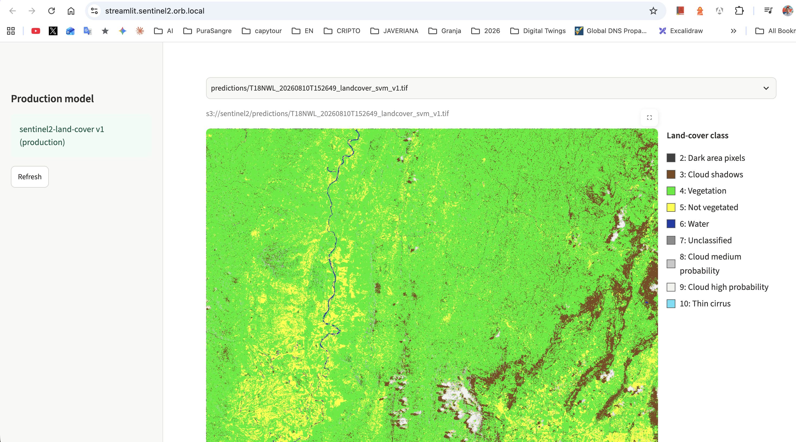

### FastAPI · pixel inference

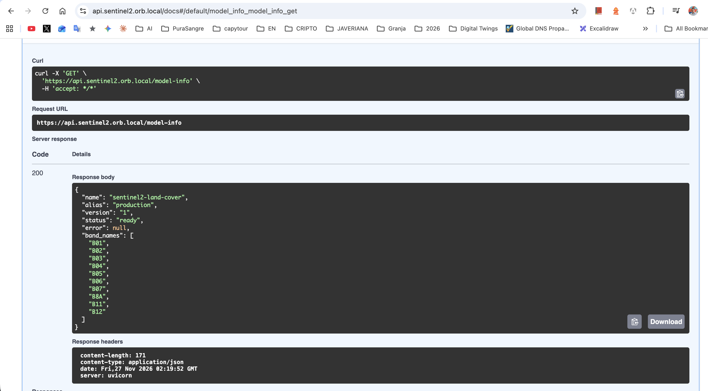
